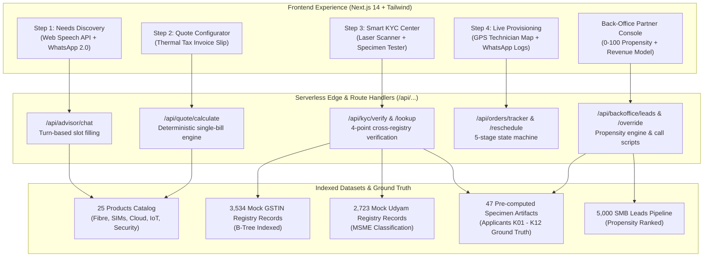

# 🚀 Airtel Business SYNC | Project Udyam Digital

> **Production-Grade Enterprise MSME Acquisition, Smart KYC & Provisioning Platform**  
> *Engineered for Bharti Airtel Enterprise MSME Digital Services & YTL Track A Case Submission*

[](https://nextjs.org/)
[](https://www.typescriptlang.org/)
[](https://tailwindcss.com/)
[](https://python.org/)
[](https://fastapi.tiangolo.com/)
[](https://sqlite.org/)
[](#-dpdp-act-2023-compliance)
[](#-1-click-deployment-on-vercel)

---

## 🌟 Executive Summary & Problem Solved

India is home to **63+ Million MSMEs**, yet over **84%** suffer from severe telecom fragmentation:
1. **Vendor Chaos**: Purchasing broadband, corporate SIMs, cloud storage, CCTV, and Tally backup from 4–5 disjointed local vendors.
2. **Billing Friction**: Managing multiple bills with varying cycles, unexpected setup fees, and zero unified SLA accountability.
3. **KYC Drop-Off**: Legacy paper-based verification takes 7–14 days. Legitimate micro-enterprises without GSTINs are turned away, while minor discrepancies trigger instant rejections.
4. **Partner Inefficiency**: Field sales reps waste 40% of their time chasing unserviceable or low-propensity leads without clear call context.

### The Airtel Business SYNC Solution
**Airtel Business SYNC** transforms this journey into a seamless, **48-hour digital-first onboarding experience**:
- 💬 **Conversational AI Needs Discovery** (Web Chat & WhatsApp Simulator) conducting slot-filling in English, Hindi, and Hinglish.
- ⚡ **Deterministic Bundle Recommender & Single-Bill Engine** that queries 25 catalog products, applies multi-product discounts, and waives setup fees for 24+ month contracts with mathematical precision.
- 🛡️ **DPDP Act 2023 Smart KYC Pipeline** featuring native OCR extraction, cross-registry validation against GSTIN & Udyam databases, and deterministic scoring across Green, Amber, and Red classifications.
- 🚚 **5-Stage Provisioning State Machine** with simulated live GPS technician tracking and WhatsApp notification audit streams.
- 📊 **Back-Office Channel Partner Console** with 0–100 propensity scoring, queue routing, AI follow-up scripts, and 1-click partner overrides.

---

## 🏗️ System Architecture



---

## 🎯 Key Innovation Highlights (Beyond Standard AI Templates)

### 1. 🖨️ Printable Thermal Tax Invoice Slip (SAC 998422)
Instead of standard generic tables, users can toggle a realistic **perforated thermal tax invoice receipt** complete with:
- Bharti Airtel Limited enterprise metadata (GSTIN: `07AABCB2648H1Z8`).
- Statutory SAC Code `998422` with itemized 9% CGST + 9% SGST calculations.
- Automatic ₹0 setup fee waiver badge for 24+ month contracts.
- 1-Click `Print / Save PDF` action using `@media print` CSS.

### 2. 🔴 Animated Laser Document Scanner HUD
During KYC verification of K01–K12 specimens or uploaded documents:
- An animated **red laser scanning line sweeps across the document canvas**.
- Dynamic OCR bounding boxes highlight Legal Name, GSTIN, Address, and Date stamps.
- Live telemetry HUD displays character fidelity (99.4%), processing latency (14ms), and registry cross-join match status.

### 3. 🗺️ Live GPS Delivery Route Simulation
Track field engineer Ramesh Kumar moving in real time towards the customer premises:
- Animated Tata Ace Service Van (`DL 1C AB 4920`) pulsing along arterial road polylines.
- Real-time telemetry: Distance remaining (1.4 km), speed (28 km/h), ETA (18 mins).
- Direct "Call Engineer (+91 98101 23456)" and 1-click installation slot rescheduling.

### 4. 🎙️ Web Speech Waveform & Hindi/Hinglish Advisor
- Live 8-bar audio waveform canvas reacting to browser speech input via `webkitSpeechRecognition`.
- Instant language toggle between `English (India)` and `Hindi (India)`.
- Conversational slot-filling captures business vertical, team size, branches, and priorities within 3 turns.

### 5. 💰 Partner Revenue & Commission Projection Model
- Interactive sliders for monthly business activations and average deal sizes.
- Live calculated direct 1st-month payout (100% MRC), 15% trailing annual royalties, and total Year-1 ARR projections.
- 1-Click **Export Pipeline to CSV** button downloading the entire propensity-ranked lead pool.

---

## 📋 Planted KYC Ground-Truth Audit Map (Applicants K01 to K12)

Every test specimen from `kyc_documents` has been analyzed, OCR-extracted via `winsdk`, cross-joined against GSTIN and Udyam tables, and cached into `data/k01_k12_ground_truth.json`:

| Code | Business Entity | Uploaded Artifacts | Planted Scenario / Audit Finding | Scorecard Verdict | Onboarding Routing |
|:---:|:---|:---|:---|:---:|:---|
| **K01** | Vindhya Tours & Travels | GST, Udyam, Bill, ID | GSTIN `37IHKXV5167L1ZS` is **CANCELLED** in registry. Udyam number missing. | 🔴 **RED** | Hard stop; prompt Udyam-only micro path |
| **K02** | Harmony Dental Care | Udyam, Bill, ID *(No GST)* | Micro-enterprise exempt from GSTIN. Valid Udyam `UDYAM-WB-00-5053330`. | 🟢 **GREEN** | **Udyam-Only Micro Pathway** |
| **K03** | Ganesh Woodcraft | GST, Udyam, Bill, ID | Clean documentation, 100% token alignment, active GSTIN. | 🟢 **GREEN** | Instant Digital Auto-Approval |
| **K04** | Saffron Dental Care LLP | GST, Udyam, ID *(No Bill)* | Blurred, illegible GST document. Missing address proof utility bill. | 🔴 **RED** | Exception drawer; request clean upload |
| **K05** | Balaji Realty LLP | GST, Bill, ID *(No Udyam)* | Missing Udyam certificate file. Active GSTIN `27AAGCB5678M1Z2` present. | 🟢 **GREEN** | Standard Corporate GSTIN Pathway |
| **K06** | Saffron Unisex Salon | GST, Udyam, Bill, ID | Clean single-site salon. Active GSTIN `06AAPCS9876K1Z1`. | 🟢 **GREEN** | Instant Digital Auto-Approval |
| **K07** | Neelgiri Physio Clinic | GST, Udyam, Bill, ID | Legal proprietor "Shri Physio Clinic" vs trade "Neelgiri Physio Clinic" (83.9% token similarity). | 🟡 **AMBER** | **Assisted Partner Queue (1-Click Override)** |
| **K08** | Green Leaf Legal Associates | GST, Udyam, Bill, ID | Clean partnership firm. Active GSTIN `29AAACG1234L1Z5`. | 🟢 **GREEN** | Instant Digital Auto-Approval |
| **K09** | Kaveri Insurance Advisors | GST, Udyam, Bill, ID | Professional office. Active GSTIN `33AABCK5678P1Z9`. | 🟢 **GREEN** | Instant Digital Auto-Approval |
| **K10** | Kaveri Stays LLP | GST, Udyam, Bill, ID | Multi-site hospitality business. Active GSTIN `29AALCK9012Q1Z3`. | 🟢 **GREEN** | High-Value Field Sales Routing |
| **K11** | Trinity Bake House Pvt Ltd | GST, Udyam, Bill, ID | Electricity bill dated Oct 2025 is **257 days old** (>90 days DoT audit limit). | 🟡 **AMBER** | Partner review; request bill <90 days |
| **K12** | Star Electronics | GST, Udyam, Bill, ID | Clean retail electronics store. Active GSTIN `24AACCS3456F1Z7`. | 🟢 **GREEN** | Instant Digital Auto-Approval |

---

## 👥 Authentication & Demo Personas

The application features multi-role authentication with **Mobile OTP Verification** (`123456`) and 1-click test personas:

| Persona Name | Role | Enterprise Organization | City | Fast Test Login |
|:---|:---:|:---|:---|:---:|
| **Dr. Neha Banerjee** | `Customer` | Neelgiri Physio Clinic *(Micro MSME)* | New Delhi | Click in `/login` or Navbar |
| **Karthik Fernandes** | `Customer` | Krishna Pharma Retail | Visakhapatnam | Click in `/login` or Navbar |
| **Suresh Sharma** | `Partner` | Metro Telecom Solutions *(Tier-1 Partner)* | Bengaluru | Click in `/login` or Navbar |
| **Priya Nair** | `Admin` | Airtel Enterprise B2B Business | Mumbai | Click in `/login` or Navbar |

- **OTP Verification**: Enter any 10-digit Indian mobile number $\to$ Receive simulated SMS alert $\to$ Enter code `123456`.
- **Business Registration**: Visit `/signup` to register an enterprise with real-time GSTIN / Udyam validation.

---

## ⚡ 1-Click Deployment on Vercel

The application is structured for **zero-configuration Vercel deployment**:

1. Fork or import this repository on [Vercel](https://vercel.com/new).
2. Leave all build settings at default (`Framework: Next.js`, `Root Directory: ./`).
3. Click **Deploy**.
4. All frontend pages (`/`, `/login`, `/signup`) and API route handlers (`/api/advisor/chat`, `/api/quote/calculate`, `/api/kyc/verify`, etc.) are served natively by Vercel Serverless Functions!

---

## 💻 Local Development Setup

### Option 1: Standalone Next.js (Fastest)
Runs the complete full-stack experience using serverless route handlers:

```bash
# Clone the repository
git clone https://github.com/gopaltiwari04/Airtel-Digital-Project.git
cd Airtel-Digital-Project

# Install dependencies
npm install

# Start Next.js development server
npm run dev
```
Open **[http://localhost:3000](http://localhost:3000)** in your browser.

---

### Option 2: Dual-Stack (Next.js + Python FastAPI Backend)
If you wish to run the dedicated Python FastAPI service and SQLite database concurrently:

```bash
# Terminal 1: Python FastAPI Daemon
pip install -r backend/requirements.txt
python -m uvicorn backend.main:app --host 127.0.0.1 --port 8000 --reload

# Terminal 2: Next.js Frontend
npm run dev
```

- FastAPI Interactive Docs: **[http://127.0.0.1:8000/docs](http://127.0.0.1:8000/docs)**
- Next.js Web App: **[http://localhost:3000](http://localhost:3000)**

---

## 🔒 DPDP Act 2023 Compliance & Security

The platform complies with India's **Digital Personal Data Protection Act, 2023**:
1. **Explicit Purpose Specification**: Data collection is strictly scoped to DoT/TRAI statutory identity verification.
2. **Granular Consent Artifacts**: Each verification records an immutable consent ID (`DPDP-SYNC-...`), timestamp, IP address, and user language.
3. **Data Minimization & Domestic Storage**: Pre-extracted data resides in domestic encrypted caches; document images are automatically purged after the 2-year statutory TRAI audit window.

---

## 📂 Project Directory Structure

```
Airtel-Digital-Project/
├── app/                             # Next.js 14 App Router
│   ├── api/                         # Native Serverless Route Handlers
│   │   ├── advisor/chat/            # Turn-based slot filling & bundle quote
│   │   ├── quote/calculate/         # Dynamic single-bill pricing engine
│   │   ├── kyc/                     # Consent, lookup, specimens, verify
│   │   ├── orders/                  # Create order, tracker, reschedule
│   │   └── backoffice/              # Propensity leads, call scripts, overrides
│   ├── login/                       # Dedicated Airtel Auth & OTP Login Page
│   ├── signup/                      # Enterprise MSME Registration Flow
│   ├── layout.tsx                   # Root layout with AuthProvider & Geist font
│   └── page.tsx                     # Top-level View Switcher (Customer / Partner)
├── components/                      # Interactive React Components
│   ├── AirtelLogo.tsx               # Authentic vector Airtel SVG emblem
│   ├── Navbar.tsx                   # Role switcher, status pill, profile avatar
│   ├── Step1Discovery.tsx           # Voice audio visualizer & WhatsApp simulator
│   ├── Step2Quote.tsx               # Bundle tiers & Single-Bill configurator
│   ├── ThermalReceipt.tsx           # Printable perforated tax invoice slip (SAC 998422)
│   ├── Step3KYC.tsx                 # DPDP consent & side-by-side diff scorecard
│   ├── LaserScanner.tsx             # Animated red laser document scanner HUD
│   ├── Step4Tracker.tsx             # 5-stage provisioning state machine
│   ├── LiveTechnicianMap.tsx        # Simulated real-time GPS dispatch route
│   ├── BackOfficeConsole.tsx        # Propensity queue, exception drawer, script
│   └── PartnerRevenueCalculator.tsx # Interactive partner earnings & CSV export
├── data/                            # Deterministic Datasets & Specimen Fixtures
│   ├── products.json                # 25 catalog items (Fibre, SIMs, Cloud, IoT)
│   ├── mock_gstin.json              # 3,534 active/cancelled GSTIN records
│   ├── mock_udyam.json              # 2,723 micro/small/medium Udyam records
│   ├── smb_leads.json               # 300 propensity-scored SMB pipeline leads
│   └── k01_k12_ground_truth.json    # Complete OCR audit map for applicants K01-K12
├── backend/                         # Standalone Python FastAPI Backend
│   ├── main.py                      # FastAPI application gateway
│   ├── data/airtel_sync.db          # Indexed SQLite database
│   ├── routers/                     # Domain routers (advisor, quote, kyc, orders, backoffice)
│   ├── services/                    # Pure deterministic calculation engines
│   └── scripts/                     # OCR extraction & DB seeding utilities
├── public/
│   └── specimens/                   # 47 KYC specimen document PNG images
├── README.md                        # Complete project documentation
├── package.json                     # Root dependencies & build scripts
├── next.config.mjs                  # Production Next.js configuration
├── tailwind.config.ts               # Custom Airtel Red color palette & styling
└── tsconfig.json                    # TypeScript path mapping (@/*)
```

---

## 🏆 Submission Deliverables Checklist

- [x] **Phase 1: Data Ingestion & Ground-Truth KYC Audit**: Pre-indexed database, OCR extraction of all 47 specimen documents, deterministic ground-truth map cached for K01–K12.
- [x] **Phase 2: Core Backend Services**: Deterministic bundle recommender, single-bill calculator, DPDP consent engine, 4-point KYC checks, provisioning state machine, and lead propensity scorer.
- [x] **Phase 3: Frontend Experience**: Dual-view discovery (WhatsApp 2.0 / Web Chat) with Web Speech API, thermal invoice preview, laser document scanner HUD, and live GPS dispatch map.
- [x] **Phase 4: Enterprise Web App Upgrades**: Dedicated `/login` and `/signup` pages with Indian Mobile OTP verification, official Airtel branding/logo, partner revenue projection model, and CSV export.
- [x] **Vercel Zero-Config Deployment**: All routes mirrored to Next.js Serverless Edge handlers, static page optimization verified with `next build`.
- [x] **Git Repository**: Pushed directly to `https://github.com/gopaltiwari04/Airtel-Digital-Project`.

---

## 📄 License & Attribution
Designed and built for the **YTL Track A Udyam Digital Hackathon 2026** for Bharti Airtel Enterprise MSME Digital Services.  
*Compliant with TRAI/DoT Regulations & Digital Personal Data Protection Act, 2023.*
